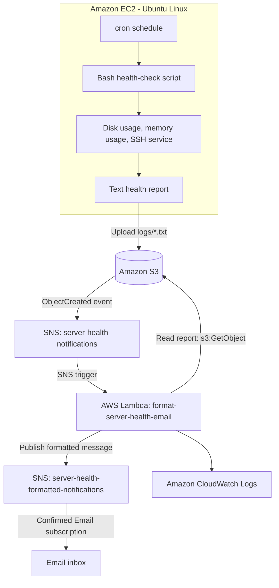

# AWS Server Health Monitoring and Alerting

**Bash-based Linux monitoring with an event-driven AWS notification pipeline.** This project checks selected EC2 health signals, stores text reports in Amazon S3, and uses Amazon SNS and AWS Lambda to deliver a readable email notification.

> **Project status:** Validate each pipeline stage before describing the complete notification flow as operational. The current health-check script covers disk usage, memory usage, and the SSH service. CPU stress has been used for testing, but automatic CPU-threshold detection must be implemented and verified in the regular monitoring script before it is claimed as a feature.

## Architecture



### Event flow

1. `cron` runs the Bash health-check script on the EC2 instance.
2. The script checks configured metrics and service state, then creates a text report.
3. The report is uploaded to the `logs/` prefix in Amazon S3.
4. An S3 `ObjectCreated` event publishes metadata to `server-health-notifications`.
5. AWS Lambda parses the SNS-wrapped S3 event and reads the report from S3.
6. Lambda formats the report as readable plain text and publishes it to `server-health-formatted-notifications`.
7. SNS emails the formatted message to a confirmed `Email` subscription. Lambda execution logs are available in CloudWatch Logs.

S3 notifications contain object metadata, not the report body. Lambda must read the S3 object to include its contents in the email.

## Features and operational skills demonstrated

- **Linux system monitoring:** Bash scripting for disk and memory thresholds and service checks.
- **Scheduled automation:** cron scheduling, execution logs, and `flock`-based overlap prevention where configured.
- **AWS cloud operations:** EC2, S3 report storage, SNS event notifications, Lambda event processing, and CloudWatch Logs.
- **Event-driven alerting:** separates the raw S3 event topic from the formatted email topic.
- **IAM least privilege:** instance role permissions for report uploads and Lambda role permissions for report reads and SNS publish operations.
- **Incident troubleshooting:** checks event routing, subscription protocol, IAM permissions, log output, and email delivery.
- **Operational documentation:** architecture diagram, deployment runbook, troubleshooting guide, validation steps, and cleanup notes.

## Technology stack

| Area | Technology | Purpose |
|---|---|---|
| Operating system | Ubuntu Linux on Amazon EC2 | Runs the health-check script |
| Scripting | Bash | Collects system health information and creates reports |
| Scheduling | cron, `flock` | Runs checks on a schedule and helps prevent overlapping runs |
| Object storage | Amazon S3 | Stores text reports under `logs/` |
| Event notifications | Amazon SNS | Delivers S3 events to Lambda and formatted notifications to email |
| Serverless processing | AWS Lambda (Python) | Reads report files and formats notification messages |
| Observability | Amazon CloudWatch Logs | Supports Lambda debugging and operational diagnosis |
| Access control | AWS IAM | Applies scoped permissions to EC2, Lambda, S3, and SNS |

## Repository structure

```text
aws-server-health-monitoring/
├── docs
│   ├── architecture.md
│   ├── deployments.md
│   └── troubleshooting.md
├── lambda
│   └── lambda.py
├── README.md
└── screenshot
    ├── email-notifications.png
    ├── lambda-configuration.png
    ├── lambda-execution-logs.png
    ├── lambda-function.png
    ├── s3-bucket-logs.png
    └── sns-subscriptions.png
 
```

Keep only files that actually exist in the repository. Add screenshots to `evidence/` after capturing them from the deployed environment; do not commit sample images as if they were production evidence.

## Prerequisites

- An AWS account with permission to configure EC2, IAM, S3, SNS, Lambda, and CloudWatch Logs.
- An Ubuntu Linux EC2 instance with Bash, AWS CLI v2, cron, `flock`, and Python 3 where required by test scripts.
- An EC2 instance profile for AWS API access. Avoid long-lived access keys in scripts or Git.
- An S3 bucket and SNS topics configured in the intended AWS Region.
- A confirmed SNS email subscription for the formatted notification topic.
- Local access to the repository and permission to install the monitoring script under `/usr/local/bin/`.

Record the actual tested versions with `cat /etc/os-release`, `bash --version`, `aws --version`, and `python3 --version`. Verify the Lambda runtime in the AWS Console rather than assuming it matches the local Python version.

## Configuration

These are the values documented for the current setup. Update the script and AWS resources consistently if the environment changes. Values may be constants inside the script rather than exported shell environment variables.

| Setting | Current documented value | Purpose |
|---|---|---|
| `AWS_REGION` | `us-east-2` | Region for S3 and SNS operations in this setup |
| `S3_BUCKET` | `ashish-server-health-logs` | Destination bucket for health reports |
| `S3_PREFIX` | `logs/` | Report object prefix and S3 notification filter |
| Disk threshold | `80%` | Disk-usage alert threshold |
| Memory threshold | `80%` | Memory-usage alert threshold |
| Monitored service | `ssh` | Service availability check |
| Lambda function | `format-server-health-email` | Formats report content for email |
| Raw event topic | `server-health-notifications` | Receives S3 object-created events |
| Formatted email topic | `server-health-formatted-notifications` | Delivers Lambda-published plain-text alerts |

**Secrets policy:** Never put AWS access keys, session tokens, private keys, passwords, or real `.env` files in this repository. Do not expose account-specific ARNs, email addresses, or sensitive host details in public screenshots. Use placeholders such as `YOUR_ACCOUNT_ID` in reusable examples.

## Operator deployment runbook

Use these steps when deploying or changing the AWS environment. Detailed instructions and permission examples are in [`docs/deployments.md`](docs/deployments.md).

1. **Verify the AWS identity and target Region.**

   ```bash
   aws sts get-caller-identity
   aws configure list
   aws s3api get-bucket-location --bucket ashish-server-health-logs
   ```

2. **Review and validate the script.** Ensure bucket, Region, report prefix, threshold checks, log paths, and state paths match the target host.

   ```bash
   sudo bash -n /usr/local/bin/server_health_check.sh
   sudo /usr/local/bin/server_health_check.sh
   sudo tail -n 80 /var/log/server_health.log
   ```

3. **Verify scheduled execution.** Confirm `/etc/cron.d/server-health-check` uses absolute paths, the correct user field, and the expected schedule. Confirm cron and log rotation are configured.

4. **Configure least-privilege IAM.** The EC2 instance role needs scoped report-upload permission. The Lambda execution role needs `AWSLambdaBasicExecutionRole`, `s3:GetObject` for report objects, and `sns:Publish` for the formatted topic.

5. **Configure event routing.** The S3 notification should match `s3:ObjectCreated:*`, prefix `logs/`, suffix `.txt`, and target `server-health-notifications`. Lambda subscribes to that raw topic. The formatted topic must have a confirmed `Email` subscription—not `Email-JSON`.

6. **Deploy and verify the Lambda formatter.** Confirm the handler is `lambda_function.lambda_handler`, the output topic ARN matches the real formatted topic, and the deployed code reads the S3 report before publishing its contents.

7. **Run the end-to-end test.** Upload a new `.txt` report under `logs/`, inspect Lambda logs in CloudWatch, and verify a readable email arrives. Remove any direct email subscription from the raw topic after confirming Lambda is subscribed, to prevent raw JSON messages.

For recovery steps and common configuration errors, use [`docs/troubleshooting.md`](docs/troubleshooting.md). Do not mark the workflow complete based only on an S3 upload or successful SNS publish; verify the email itself.

## Developer test loop

Run these checks before committing changes to a Bash script:

```bash
bash -n scripts/server_health_check.sh
shellcheck scripts/server_health_check.sh  # Install ShellCheck first, if available
```

Exercise tests with clearly labeled test reports and disposable test services. Avoid stopping SSH, exhausting instance memory, deleting production objects, or changing thresholds on the production script just to produce a screenshot. Distinguish simulated test messages from conditions actually detected by the monitoring script.

## Validation and current limitations

| Capability | Current scope | Validation needed |
|---|---|---|
| Disk monitoring | Configured threshold check | Confirm measured value, threshold decision, report, and alert path |
| Memory monitoring | Configured threshold check | Confirm real measured memory use and alert handling |
| SSH service check | Configured service check | Confirm observed systemd state and safe failure reporting |
| CPU monitoring | Temporary CPU load has been used for demonstrations | Implement and test CPU measurement and threshold logic in the regular script before claiming detection |
| S3 report storage | Reports upload to the configured bucket | Confirm object and key under `logs/` |
| SNS → Lambda → SNS routing | Intended event-driven notification flow | Confirm successful Lambda invocation and publish logs |
| Readable email | Lambda formats a plain-text message | Confirm the formatted topic uses protocol `email` and verify the message in the inbox |
| Automated recovery | Not implemented | Do not claim self-healing or automatic remediation |

## Screenshots 

Add authentic, sanitized screenshots that prove each stage:

- EC2 terminal showing the monitoring script and measured output.
- S3 object listing showing a timestamped `.txt` report under `logs/`.
- SNS subscription pages showing Lambda on the raw topic and a confirmed `Email` subscription on the formatted topic.
- Lambda trigger and a successful CloudWatch invocation.
- A received email showing the readable subject and separate report sections.

Store evidence under the `screenshot/` directories shown above. Redact sensitive account, identity, network, and email details before publishing.

## Troubleshooting and recovery

- **Raw JSON email:** Check for a direct email subscription on `server-health-notifications`, verify the formatted topic uses protocol `email`, and confirm Lambda publishes the report text to the formatted topic.
- **Topic `NotFound`:** Check account and Region using `aws sts get-caller-identity` and `aws sns list-topics --region us-east-2`.
- **Lambda `AccessDenied`:** Review scoped `s3:GetObject` and `sns:Publish` permissions on the execution role.
- **No Lambda invocation:** Check the SNS trigger, S3 event prefix/suffix filters, and SNS topic resource policy.
- **cron failures:** Check the cron service, `/etc/cron.d/server-health-check`, `flock`, and `/var/log/server_health_cron.log`.
- **No CPU alert:** Confirm CPU threshold logic exists in the regular monitoring script; a separate stress test does not prove monitoring detection.

See [`docs/troubleshooting.md`](docs/troubleshooting.md) for diagnostic commands and detailed recovery guidance.

## Security, cost, and scope

- Use IAM roles and least-privilege policies; avoid static credentials and unrestricted administrator access.
- Keep S3 reports private and limit their contents to operational information needed for the project.
- Review AWS charges for EC2 runtime, S3 storage/requests, SNS notifications, and Lambda invocation.
- This repository documents a manually configured AWS workflow. It does not currently provide Terraform-managed infrastructure, S3 remote state, an automated CI/CD pipeline, zero-downtime deployment, or automatic incident remediation. These can be considered as future extensions when implemented and tested.
- Follow the deployment and troubleshooting runbooks when updating AWS resource names, Regions, permissions, or report formats so the documentation stays aligned with the implementation.

## Documentation

- [Architecture](docs/architecture.md) — system design, event flow, IAM boundaries, and monitoring scope.
- [Deployment runbook](docs/deployments.md) — prerequisites, installation, AWS configuration, and verification.
- [Troubleshooting guide](docs/troubleshooting.md) — diagnosis and recovery for notification, permissions, scheduling, and alert issues.
