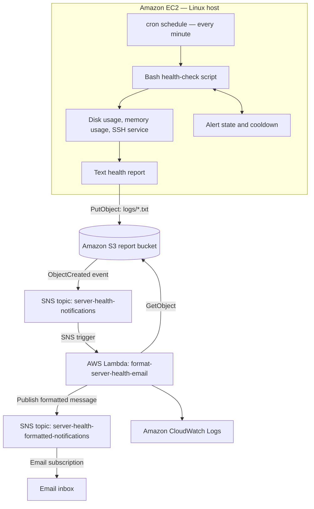

# Server Health Monitoring and Alerting — Architecture

## Purpose

This project demonstrates Linux server monitoring and event-driven alert delivery using Bash and AWS services. A scheduled health-check script runs on an Amazon EC2 instance, evaluates configured health signals, writes a report, and uploads alert reports to Amazon S3. An S3 object-created event is published to Amazon SNS. AWS Lambda consumes that event, retrieves the report from S3, formats a plain-text notification, and publishes it to a separate SNS topic for email delivery.

The architecture is designed as a learning project and Validate each stage with the checks in [`deployments.md`](deployments.md) before describing the entire pipeline as operational.

## Architecture diagram

## Components and responsibilities

| Component | Responsibility | Configuration to verify |
|---|---|---|
| Amazon EC2 | Hosts the Linux monitoring script. The instance can run in a different AWS Region from the S3/SNS workflow. | Instance is running; AWS CLI is available; an attached IAM instance profile is used instead of long-lived access keys. |
| Bash health-check script | Collects configured system health signals, evaluates thresholds, and generates a report. | Current script checks disk, memory, and the SSH service. Confirm the script contents before claiming CPU threshold detection is implemented. |
| cron and `flock` | Runs the script periodically and prevents overlapping executions. | `/etc/cron.d/server-health-check` contains the correct user and paths; the lock path is writable by the script's execution user. |
| Amazon S3 | Stores report objects under the `logs/` prefix. | Bucket name, bucket Region, object prefix, and suffix filter match the script. |
| SNS raw-event topic | Receives S3 object-created notifications and invokes Lambda through an SNS subscription. | `server-health-notifications` has a Lambda subscription. Do not keep a direct email subscription here if raw JSON emails are unwanted. |
| AWS Lambda | Parses the SNS-wrapped S3 event, reads the report from S3, formats a plain-text message, and publishes it to the formatted topic. | Function name: `format-server-health-email`; handler: `lambda_function.lambda_handler`; Region: `us-east-2`. |
| SNS formatted-notification topic | Delivers the text published by Lambda to an email endpoint. | `server-health-formatted-notifications` has a confirmed `Email` subscription, not `Email-JSON`. |
| Amazon CloudWatch Logs | Captures Lambda execution logs for diagnostics. | The Lambda execution role includes `AWSLambdaBasicExecutionRole`. |

## Event and data flow

1. cron starts the monitoring script on its configured schedule.
2. The script checks its configured health signals and writes diagnostic information to a report. Alert state and cooldown files help avoid repeatedly sending the same alert, where implemented.
3. The script uploads the report to `s3://ashish-server-health-logs/logs/` using the bucket's Region (`us-east-2`). The EC2 instance can be in `us-east-1`; the S3 CLI operation must still target the bucket's Region.
4. S3 emits an `ObjectCreated` notification for matching `.txt` objects under `logs/` and publishes the event to `server-health-notifications`.
5. The SNS event triggers `format-server-health-email`.
6. Lambda parses the event payload, decodes the object key, downloads the report using `s3:GetObject`, and builds a readable plain-text email body.
7. Lambda calls `sns:Publish` on `server-health-formatted-notifications`.
8. SNS sends the published subject and message to the confirmed email subscription.

S3 notifications include object metadata, not the contents of the report. Lambda must explicitly read the object from S3 if the email is to include the report text.

## Regions and resource names

| Resource | Expected value |
|---|---|
| S3 bucket | `ashish-server-health-logs` |
| S3 report prefix | `logs/` |
| S3 report suffix | `.txt` |
| S3 bucket Region | `us-east-2` |
| SNS raw-event topic | `server-health-notifications` |
| SNS formatted-email topic | `server-health-formatted-notifications` |
| Lambda function | `format-server-health-email` |
| Lambda Region | `us-east-2` |
| EC2 monitoring script | `/usr/local/bin/server_health_check.sh` |
| Monitoring log | `/var/log/server_health.log` |
| cron output log | `/var/log/server_health_cron.log` |

Use the real values from the AWS account when deploying. Do not commit account IDs, email addresses, credentials, private keys, or sensitive log contents to a public repository.

## IAM and security boundaries

Use separate least-privilege permissions for the EC2 instance and Lambda function.

- **EC2 instance role:** allow `s3:PutObject` only to `arn:aws:s3:::ashish-server-health-logs/logs/*`, plus any additional read or service permissions that the actual script requires. Prefer an EC2 instance profile over static AWS access keys.
- **Lambda execution role:** attach `AWSLambdaBasicExecutionRole`; allow `s3:GetObject` for `arn:aws:s3:::ashish-server-health-logs/logs/*`; allow `sns:Publish` only to the formatted SNS topic ARN.
- **S3-to-SNS permission:** the raw topic policy must allow `s3.amazonaws.com` to publish, restricted to the intended bucket and source account.
- **SNS subscriptions:** the raw topic should invoke Lambda; the formatted topic should email the recipient. Avoid a direct email subscription to the raw topic when human-readable notifications are expected.
- Do not publish report contents to public locations. Reports should contain only information needed for operations and learning evidence.

## Monitoring scope and current limitations

The production health-check script described for this project checks disk usage, memory usage, and the SSH service, with configured thresholds and alert-state handling. CPU load has also been used for a test demonstration, but the demonstration workload does **not** prove the regular health-check script detects CPU thresholds. Add and validate an actual CPU metric check before documenting CPU alert detection as an implemented monitoring feature.

The test script can label memory or service conditions as simulated. A report containing a simulated alert proves the notification path can transport a report; it does not prove the monitoring script detected a real incident. Likewise, a successful SNS publish confirms that SNS accepted the message, while end-to-end email delivery still needs to be verified in the inbox.

The current formatter sends structured plain-text email. It is not an HTML email template and does not itself remediate a failed service or change an EC2 instance's capacity.

## Operational validation checklist

- [ ] Manual execution of the script completes successfully.
- [ ] The script's measured values and threshold decisions match the host's actual state.
- [ ] cron runs on schedule and overlapping runs are prevented where configured.
- [ ] A report object appears under the expected S3 prefix.
- [ ] S3 publishes an object-created notification to the raw SNS topic.
- [ ] The raw SNS topic invokes Lambda.
- [ ] Lambda can read the S3 object and logs a successful formatted publish.
- [ ] The formatted SNS topic has a confirmed `Email` subscription.
- [ ] A new test upload results in a readable email, not an SNS JSON envelope.
- [ ] Cleanup and IAM permissions are reviewed before calling the setup production-ready.
